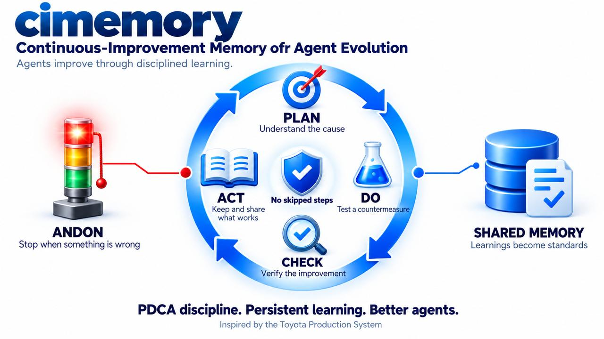

# cimemory — Continuous-Improvement Memory for Agent Evolution

A **memory plugin** that gives an autonomous agent the improvement discipline of
the Toyota Production System: kaizen, PDCA/TBP, genchi genbutsu, jidoka & andon,
hansei, yokoten, and standard work.

It is not a vector store and not a chat log. It is a **semantic memory layer that
enforces the loop** — it refuses to record an unverified root cause, refuses to
standardise a gain that was never checked, and refuses to lock a change in
without reflection.


*The PDCA discipline loop: plan with root-cause evidence, do a countermeasure, check the improvement, act by standardising and sharing — with andon stopping the line when something is wrong.*

```python
from cimemory import EvolutionMemory, KaizenLoop, KaizenSpec, get_backend

mem  = EvolutionMemory(get_backend("sqlite", path="evolution.db"), agent="balboa")
loop = KaizenLoop(mem)

mem.observe("mean_tool_calls_per_task", 14.1, source="run-traces")
outcome = loop.run(KaizenSpec(capability="tool-call-efficiency", ...))

print(outcome.improved)          # True
print(outcome.standard_version)  # 1  -> the old baseline is superseded
print(outcome.a3)                # the whole PDCA story on one sheet
```

---

## Why

Toyota's improvement advantage is not the tools — it is the **discipline the
tools enforce**. Five of the eight problem-solving steps are Plan, because most
failures come from rushing understanding. Standards are frozen so a gap becomes
measurable. Countermeasures are separated from containment so a symptom is never
mistaken for a fix. Reflection is mandatory *even on success*.

An agent that "improves" without that discipline produces exactly the waste the
system exists to remove: it re-derives what it forgot, patches symptoms, and
declares victory at implementation. This repo ports the discipline into code, so
the loop cannot skip it.

Full research: [`docs/research/toyota-continuous-improvement.md`](docs/research/toyota-continuous-improvement.md)

---

## The loop

| PDCA | TBP step | In code |
|---|---|---|
| Plan | 1 clarify the problem | `open_problem(capability, ideal, actual, gap)` |
| Plan | 2 break it down | `breakdown=[...]`, `priority_point=...` |
| Plan | 3 set a target | `set_target(metric, baseline, goal, deadline)` |
| Plan | 4 analyse the root cause | `ask_why(...)` ×5 + `assert_root_cause(..., verified_by=...)` |
| Plan | 5 develop countermeasures | `propose_countermeasure(..., strength=TAISAKU)` |
| Do | 6 see them through | `start_experiment(...)`, `log_do(...)` |
| Check | 7 evaluate results **and** process | `check(after_value, process_holds=True)` |
| Act | 8 standardise, spread, reflect | `standardise(...)`, `yokoten(...)`, `hansei(...)` |

Plus the two mechanisms that make it survive contact with reality:

- **Jidoka / andon** — `mem.andon(reason, severity="critical", stopped=True)`
  stops the line the moment an abnormality appears.
- **Sustain** — `loop.audit_standard(capability, observed_value)` detects standard
  drift later and raises an andon. Standards decay; this is the follow-up.

---

## Enforced discipline

These are real exceptions, not comments. Each has a test.

```
DisciplineError: a taisaku must name the root cause it addresses
DisciplineError: an unverified root cause may not be recorded: name the
                 observation or measurement that proves it (genchi genbutsu)
DisciplineError: the 5-Why chain fails the Therefore Test
DisciplineError: cannot standardise: the Check did not pass on both results
                 and process
DisciplineError: cannot standardise without hansei: reflection is mandatory
                 before a gain is locked into the standard
DisciplineError: cannot spread a superseded standard
KaikakuNotApproved: kaikaku changes the roots of the standard and requires an
                 explicit approval token
```

A memory that merely records is a filing cabinet. A memory that refuses is a
learning loop.

---

## Database-agnostic by design

```
EvolutionMemory ──► MemoryBackend (Protocol: 10 methods)
                        ├── InMemoryBackend   no deps, not durable
                        ├── SQLiteBackend     durable, transactional, versioned
                        ├── JsonlBackend      minimal, file-based
                        └── <your adapter>    Postgres, Redis, pgvector, S3, ...
```

The plugin imports no database driver. Capability differences — durability,
transactions, versioning, text/vector search — are negotiated through
`capabilities()`, never assumed. Add a store by implementing ten methods and
calling `register_backend("name", factory)`.

The requirements any store must satisfy are specified in
[`docs/requirements/generic-memory-requirements.md`](docs/requirements/generic-memory-requirements.md):
14 functional requirement groups (R1–R14) with acceptance criteria, non-functional
targets, an anti-requirements section, a capability matrix, and a conformance
suite.

---

## The Gemba Board (visualization)

```bash
python3 -m cimemory.dashboard        # -> http://127.0.0.1:8700
```

A replayable board of one improvement programme, in the visual language of a shop
floor: andon lamps, hazard tape, graph-paper ground, punched A3 dockets. Every
view is a **Toyota management artifact**, not a chart.

| View | Toyota artifact |
|---|---|
| **Andon Board** | the andon board above the line — five stations, their lamps, standards vs actual, waste class, and the log of stop-the-line signals and refusals |
| **The Wheel** | PDCA / Toyota Business Practices — the eight TBP steps, five of them Plan |
| **The Staircase** | standard work as a ratchet — the standard never lowers, the no-memory control drifts the other way |
| **The A3** | the single-sheet report — left Plan, right Do-Check-Act |
| **The Five Whys** | the causal ladder at the gemba, plus the Therefore Test read backwards |
| **The Ledger** | muda accounting and the countermeasure strength ladder (taisho -> taisaku -> mizen-boushi) |
| **Yokoten** | horizontal spread of a proven standard to sibling agents |

The telemetry is **not a mock**: `dashboard/capture.py` drives the real
`EvolutionMemory` + `KaizenLoop` through seven cycles and snapshots the store
after every semantic event, so each frame shows what the plugin actually held at
that instant. Deterministic, and served with **zero dependencies** - the server is
`http.server`, the frontend is hand-written SVG and plain JavaScript.

Design rationale, frame schema and how to add a view:
[`docs/visualization/gemba-board.md`](docs/visualization/gemba-board.md)

---

## Live: the board reads production memory (read-only)

By default the board opens on **real agent telemetry in Tarantool** (port
3301), not on the script:

```
live · ratiocore agent memory @ 127.0.0.1:3301 (tool_event + turn_traces, role=guest, select-only)
```

It reads the **whole evidence base**, not just the memory space: `tool_event`
(11 864 tool calls — the defect ledger), `turn_traces` (what a turn cost),
`agent_runtime_config` + `agent_revision` (the revision timeline, read only as
a time marker), and `rb_insight` (documented insights and their `uses`
counter). The board states which ledger it used (`meta.defect_source`) and
which spaces it could not read.

Each agent becomes a station, each tool call whose recorded status is not `ok`
becomes a defect, and the standard is the fleet median. Measured over the whole
ledger: **11 868 tool calls, 1 000 defects, fleet rate 8.43 per 100 against a
standard of 7.67 — four stations abnormal** (predman 17.26, geosupply 10.66,
tanya 10.16, ginger 8.12). The chip in the header swaps to the demo and back;
if the memory is unreachable the server falls back to the demo **and says so**.

Three things the measurement reports about *itself*, because they are the
result:

* **Coverage** — only **661 of 11 868 events (5.6 %)** are attributable to a
  configuration at all. The rest come from agents with no runtime config, and
  those are the high-volume ones (`ginger`, `tanya`, `trin`).
* **Comparability** — every station's *after* window holds fewer than 30
  events, so no before/after claim is supportable anywhere. Thin windows are
  drawn hollow and labelled `NOT COMPARABLE`.
* **Non-adoption** — of 83 documented insights, **61 were never used once**.
  They are drawn as *not-spread*: written down and never applied, let alone
  passed to a sibling.

The wiring **never writes back**. Four things enforce it: the connection role
(`guest`, no space grants), the statements (`select` only), a runtime guard
that raises if the user could write, and a test that inspects the module's own
source for mutation calls. Because an observer may see and stratify a gap but
may not act on it, live mode performs **steps 1 and 2 of the ten** and reports
the rest as not performed — the wheel lights two steps, and `cycles run` reads
*not run*. The A3 of the worst station shows an empty root cause, because
memory holds none.

```bash
python3 -m cimemory.dashboard --host 0.0.0.0 --port 8700   # live, LAN-visible
python3 -m cimemory.dashboard --source demo                # the scripted programme
```

Full contract, space schema and the Toyota→memory mapping table:
[`docs/integration/live-agent-memory.md`](docs/integration/live-agent-memory.md)

---

## Experiment 001

`experiments/experiment_001_kaizen_cycle.py` runs a complete TBP cycle — a
14-tool-call-per-task agent improving to 5.4 against a standard of 6 — over
**all three backends**, and verifies two things: the discipline guards fire, and
the outcome is identical regardless of storage.

Verified output:

```
portable across backends: True
discipline enforced:      True
```

Run it:

```bash
python experiments/experiment_001_kaizen_cycle.py
python -m pytest tests/ -q        # 105 passed
```

---

## Layout

```
cimemory/
├── cimemory/
│   ├── models.py      12 record kinds, mapped to Toyota concepts
│   ├── backend.py     the DB-agnostic contract (10 methods)
│   ├── plugin.py      EvolutionMemory: semantics + enforcement + A3
│   ├── loop.py        KaizenLoop, KaizenSpec, kaizen/kaikaku gate
│   └── backends/      memory · sqlite · jsonl
│   ├── live/          READ-ONLY wiring to production agent memory
│   │   ├── source.py        Tarantool reader + the Toyota derivation
│   │   └── capture_live.py  the same frame contract, from real memory
│   └── dashboard/     the Gemba Board (stdlib server + static UI)
│       ├── capture.py   deterministic telemetry over the real plugin
│       ├── server.py    http.server, no dependencies; ?source=live|demo
│       └── static/      index.html · css · js (7 views, hand-written SVG)
├── docs/
│   ├── research/      the full Toyota methodology research
│   ├── architecture/  concept→code map, invariants, wiring
│   ├── requirements/  generic (DB-agnostic) memory requirements
│   ├── integration/   the read-only production wiring
│   └── visualization/ the Gemba Board: design language + frame schema
├── experiments/       experiment_001 — the real cycle
└── tests/             contract, discipline, loop, portability, dashboard
```

---

## Scope of this repo

Implemented: the **memory plugin for agent evolution** (the loop, the record
model, the enforcement, three reference backends), the **generic memory
requirements** that make the evolution work, and the **Gemba Board**
visualization of a full improvement programme.

Deliberately not implemented here: a production database adapter, an embedding
pipeline, and the agents themselves. Those plug into the contract above.

No third-party dependencies. Python 3.10+ standard library only.
